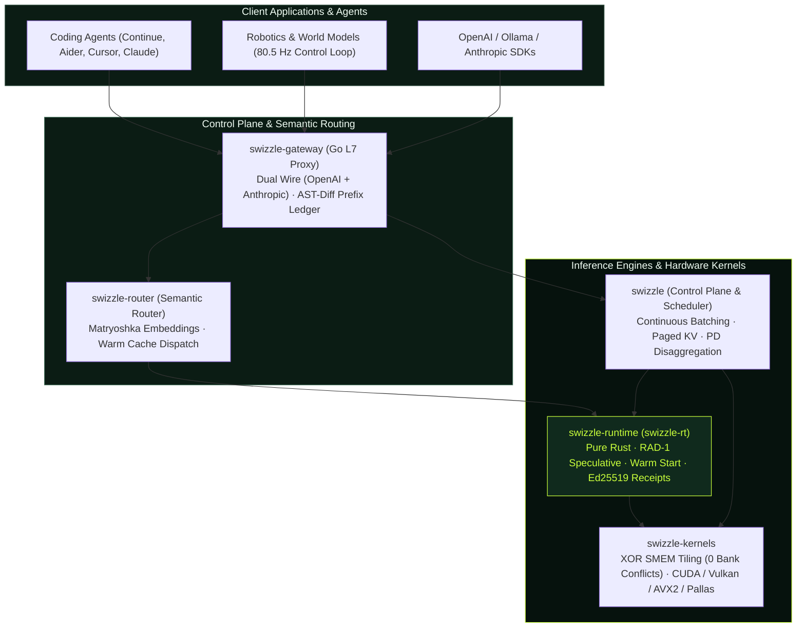

<div align="center">


<br />


# Swizzle AI

### *Inference that remembers what it already read.*

**Sub-40ms cached TTFT · Zero shared-memory bank conflicts · Verifiable Ed25519 receipts**

[-c9ff3b?style=for-the-badge&logo=rust&logoColor=black)](https://github.com/Swizzle-AI/swizzle-runtime)
[-c9ff3b?style=for-the-badge&logo=adobeacrobatreader&logoColor=black)](https://github.com/Swizzle-AI/swizzle-runtime/blob/main/docs/Swizzle_Runtime_Technical_Report.pdf)
[](https://swizzle-ten.vercel.app)
[](https://swizzle-ten.vercel.app/#student-playground)
[](https://x.com/Swizzler112)
[](https://github.com/Swizzle-AI/swizzle-runtime/blob/main/LICENSE)

</div>

---

## 🌐 Ecosystem Architecture

Swizzle AI is an open-source inference stack built for **local edge GPUs, autonomous coding agents, and real-time robotics world models**.



---

## 📦 Core Repositories

| Repository | Description | Stack | Status |
| :--- | :--- | :--- | :--- |
| **[`swizzle-runtime`](https://github.com/Swizzle-AI/swizzle-runtime)** | Pure-Rust GGUF local inference engine (`swizzle-rt`) with AVX2, CUDA (`sm_75`–`sm_120`), Vulkan, RAD-1 speculative decoding, and Ed25519 receipts. | Rust, CUDA, Vulkan | **v0.1.0 Live** |
| **[`swizzle`](https://github.com/Swizzle-AI/swizzle)** | Core continuous batching engine, AST-diff virtual paging (`Swizzle-Tree`), speculative decoding, and prefill-decode disaggregation. | Python, C++, PyTorch | **Main Engine** |
| **[`swizzle-gateway`](https://github.com/Swizzle-AI/swizzle-gateway)** | Sub-millisecond L7 reverse proxy supporting OpenAI (`/v1/chat/completions`) and Anthropic (`/v1/messages`) wire protocols. | Go 1.22+ | **Active** |
| **[`swizzle-kernels`](https://github.com/Swizzle-AI/swizzle-kernels)** | Hardware-roofline fused mega-kernels: XOR shared-memory bank conflict elimination, speculative verification, and TPU Pallas VMEM attention. | CUDA C++, Triton, JAX | **High Performance** |
| **[`swizzle-router`](https://github.com/Swizzle-AI/swizzle-router)** | Semantic intent router, Matryoshka embedding pipelines, and prefix-affinity multi-cluster load balancing. | Python, PyTorch | **Active** |
| **[`swizzle-python-sdk`](https://github.com/Swizzle-AI/swizzle-python-sdk)** | Official Python client library (`pip install swizzle-ai`) with speculative stream unpacking and robotics telemetry. | Python | **v0.3.0** |
| **[`swizzle-robotics`](https://github.com/Swizzle-AI/swizzle-robotics)** | Real-time robotics world models, 80.5 Hz visual servoing, 50 Hz quintic spline smoothing, and Student Robotics Playground. | Python, React, WebRTC | **Production** |

---

## 📊 Verified Local Inference Benchmarks (`swizzle-rt v0.1.0`)

📄 **[Read the Full 28-Page Technical Report (`SWZ-TR-2026-01`, PDF)](https://github.com/Swizzle-AI/swizzle-runtime/blob/main/docs/Swizzle_Runtime_Technical_Report.pdf)** — First-principles derivations, coding decisions across all 10 Rust crates, XOR-swizzled Tensor-Core GEMM proofs (`gemm_swizzle(r, b) = b ^ ((r & 7) << 4)`), Cauchy-Schwarz + IEEE-754 `Shortlist` vocabulary screening bounds, `RAD-1` ensemble speculative decoding, and head-to-head hardware telemetry.

<p align="center">
  
</p>

---

## ⚡ Quick Start

* **One-Command Install (`swizzle-rt` Linux x86_64 CUDA 12.8)**:
  ```sh
  curl -fsSL https://raw.githubusercontent.com/Swizzle-AI/swizzle-runtime/main/install.sh | sh
  ```
* **Run via Docker (GHCR)**:
  ```sh
  docker run --rm -p 8080:8080 -v "$PWD/models:/models:ro" ghcr.io/swizzle-ai/swizzle-runtime:latest /models/model.gguf
  ```
* **Python SDK & Live Platform**: `pip install swizzle-ai` · [swizzle-ten.vercel.app](https://swizzle-ten.vercel.app)

---

<div align="center">

**Swizzle AI is open-source under the Apache 2.0 License.**

</div>
